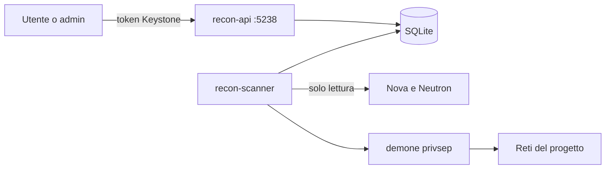

# Recon-Stack

**Service discovery senza agenti per OpenStack.** Scopre quali host e quali servizi girano davvero nelle reti di un progetto, li confronta con ciò che OpenStack dichiara e li pubblica in un catalogo consultabile da API REST e dashboard, aggiornato periodicamente.

> Progetto didattico per il corso di laurea magistrale in Sicurezza Informatica e Tecnologie Cloud (UNISA), sviluppato e provato esclusivamente in laboratorio su un'installazione DevStack dell'autore. È uno strumento difensivo di inventario: le scansioni riguardano solo le reti del progetto a cui sono rivolte.

---

## Scheda

| | |
| --- | --- |
| **Tipo** | nuovo servizio OpenStack, installato come plugin DevStack |
| **Linguaggio** | Python |
| **Componenti integrati** | Keystone (autenticazione), Nova e Neutron (sola lettura), Horizon (dashboard) |
| **Interfacce** | API REST sulla porta 5238, comandi `openstack recon`, dashboard come plugin di Horizon |
| **Strumenti** | nmap, Graphviz |

---

## Il problema

OpenStack sa **cosa è dichiarato**: quali VM esistono, che indirizzi hanno, quali porte apre il firewall. Non sa **cosa gira davvero**: se sulla porta 22 c'è OpenSSH e in che versione, se nella rete risponde un host che nessuno ha registrato, se una regola del firewall apre una porta su cui non ascolta niente.

Gli strumenti che OpenStack offre (Horizon, il DNS Designate, il progetto di ricerca Searchlight, ritirato nel 2020) conoscono solo il dichiarato. Recon-Stack aggiunge l'osservato, senza installare niente dentro le VM.

## Cosa fa

- Legge da Nova e Neutron l'**inventario** del progetto: VM, porte, IP, floating IP, security group.
- Scopre gli **host attivi** nelle reti del progetto e segna come **sconosciuti** quelli che non hanno una porta Neutron.
- Scopre i **servizi** in ascolto: porta, protocollo, nome, versione.
- Li raccoglie in un **catalogo** cercabile per servizio, host, rete e versione.
- Ripete la scoperta **periodicamente** e mostra le **differenze** rispetto alla volta precedente.
- Distingue i servizi **interni** da quelli **esposti** tramite floating IP, e segnala le **regole di firewall inutili** e i **servizi latenti**.
- Produce una **mappa** della topologia e un **report** HTML/PDF, anche in versione condivisibile con indirizzi e identificativi oscurati.

## Vincoli di sicurezza

- Scansiona **solo** indirizzi delle subnet del progetto in Neutron e i suoi floating IP ([0005](docs/adr/0005-perimetro-da-neutron.md)).
- Le scansioni le avvia **solo chi ha il ruolo admin**, con un limite di frequenza ([0002](docs/adr/0002-autenticazione-keystone.md)).
- Ogni scansione viene registrata: chi, quando, su quale perimetro.
- Le operazioni privilegiate sono confinate in un demone privsep ([0007](docs/adr/0007-privilegi-oslo-privsep.md)).

## Cosa non fa

Non entra nelle VM e non installa agenti. Non modifica risorse OpenStack: non crea VM, porte né regole di firewall. Non cerca vulnerabilità né tenta di sfruttarle: rileva servizi e versioni.

---

## Architettura



Componenti, confini e sequenza di una scansione: [docs/architettura.md](docs/architettura.md).

---

## Provarlo

Nel `local.conf` di DevStack:

```ini
[[local|localrc]]
enable_plugin recon-stack https://github.com/suonatorefelice/recon-stack main
```

Un `local.conf` completo, con le impostazioni per una VM su Mac con chip Apple M1, è in [devstack/local.conf.sample](devstack/local.conf.sample).

Dopo `./stack.sh`:

```console
$ curl http://<host>:5238/health
{"status":"ok"}
$ sudo systemctl status devstack@recon-api devstack@recon-scanner
$ openstack catalog list        # compare il servizio recon-stack, tipo recon
```

### Verificare l'inventario (step 4)

Sul nodo DevStack, con le credenziali admin caricate:

```console
$ source /opt/stack/devstack/openrc admin admin
$ bash demo/setup_demo.sh                          # crea il progetto recon-demo
$ recon-stack-inventory --project recon-demo \
    --config-file /etc/recon-stack/recon-stack.conf
```

Il riepilogo stampato deve coincidere con:

```console
$ openstack server list      --project recon-demo
$ openstack port list        --project recon-demo
$ openstack floating ip list --project recon-demo
```

### Eseguire una scansione (step 6 e 7)

Sempre sul nodo DevStack, dopo aver creato il progetto demo. La scansione entra
nelle network namespace di Neutron, quindi va lanciata con `sudo`:

```console
$ sudo recon-stack-scan --project recon-demo \
    --config-file /etc/recon-stack/recon-stack.conf
```

Stampa gli host trovati divisi in **censiti** (le VM demo, con il loro nome),
**sconosciuti** (rispondono ma senza porta Neutron) e **assenti** (hanno una
porta ma non rispondono), con sotto ciascuno i **servizi** in ascolto (porta,
protocollo, nome, prodotto, versione; es. `22/tcp ssh OpenSSH 8.9p1`).

### Consultare i risultati: API e comandi (step 8)

I risultati si leggono dalla API REST (serve un token admin) o, più comodamente,
con i comandi `openstack recon`, che usano il token dell'utente collegato:

```console
$ openstack recon scan list                      # le scansioni, dalla più recente
$ openstack recon host list --project recon-demo # gli host dell'ultima scansione
$ openstack recon service list --name ssh        # cerca un servizio nel catalogo
$ openstack recon host show <id-host>            # un host e i suoi servizi
```

Le stesse cose via API, ad esempio:

```console
$ curl -H "X-Auth-Token: $OS_TOKEN" http://<host>:5238/v1/services?name=ssh
```

### Dashboard (step 9)

Il plugin installa anche i pannelli in Horizon: entra nella dashboard come admin
e apri **Progetto → Recon** (host, servizi, scansioni). Il dettaglio di una
scansione mostra anche il diff e le segnalazioni di esposizione.

### Scansione periodica e diff (step 10)

Lo scanner può eseguire da solo le scansioni richieste via API e ripeterle a
intervalli. Nel file `/etc/recon-stack/recon-stack.conf`, sezione `[scanner]`:

```ini
periodic_scan_interval = 3600        # ogni ora
periodic_projects = recon-demo
```

Il confronto fra una scansione e la precedente (host e servizi comparsi o
spariti) si vede con `openstack recon scan diff <id-scansione>`: avviando o
fermando un servizio su una VM demo, il diff lo mostra.

### Esposizione (step 11)

Il confronto fra i servizi trovati e i security group produce delle
**segnalazioni** (regola inutile, servizio latente, esposizione eccessiva, host
non censito, floating IP inutile). Il progetto demo contiene regole volutamente
sbagliate, che devono comparire qui:

```console
$ openstack recon scan exposure <id-scansione>
$ openstack recon scan exposure <id-scansione> --severity high
```

### Report e mappa (step 12)

Da una scansione già fatta si genera un report HTML con la mappa della topologia,
più una versione **condivisibile** con indirizzi e nomi oscurati:

```console
$ recon-stack-report --project recon-demo --output /tmp/report \
    --config-file /etc/recon-stack/recon-stack.conf
$ recon-stack-report --project recon-demo --output /tmp/report --redacted
```

Apri `/tmp/report/report.html` nel browser (e stampalo su PDF da lì, oppure usa
`--pdf` se è installato weasyprint). La mappa compare se è installato Graphviz
(`dot`), che il plugin DevStack installa da sé.

Lo stato di avanzamento degli step è in [docs/piano.md](docs/piano.md).

## Sviluppo in locale

Il codice si sviluppa e si prova anche senza DevStack:

```console
$ python3 -m venv .venv
$ .venv/bin/pip install -e . -r test-requirements.txt tox
$ .venv/bin/tox -e py3                                            # test unitari
$ .venv/bin/flask --app recon_stack.api.app:create_app run --port 5238
$ .venv/bin/recon-stack-scanner                                   # Ctrl+C per fermarlo
```

I test unitari (`tox -e py3`) girano senza OpenStack. Il percorso completo su un
DevStack vero si prova invece con i test tempest in
[recon_stack/tests/tempest](recon_stack/tests/tempest/README.md).

---

## Documenti

| Documento | Contenuto |
| --- | --- |
| [Concetti](docs/concetti.md) | OpenStack, DevStack, plugin, nmap e namespace di rete spiegati da zero |
| [Glossario](GLOSSARY.md) | i termini del dominio e dei componenti OpenStack |
| [Architettura](docs/architettura.md) | componenti, confini, sequenza di una scansione, dati conservati |
| [Decisioni](docs/adr/README.md) | le scelte di forma, con alternative scartate e fonti |
| [Piano](docs/piano.md) | gli step di sviluppo e come si verifica ciascuno |
