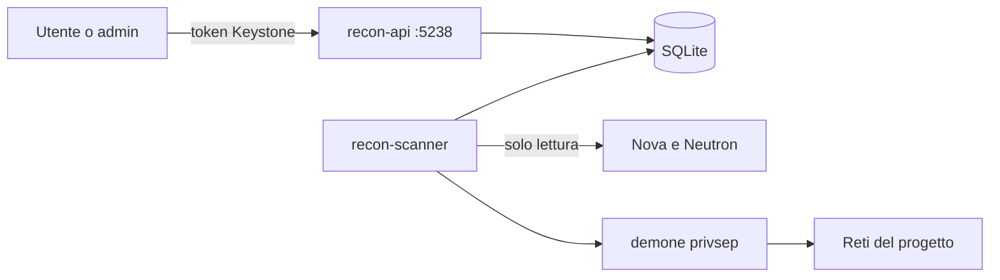

# Recon-Stack

**Service discovery senza agenti per OpenStack.** Scopre quali host e quali servizi girano davvero nelle reti di un progetto, li confronta con ciò che OpenStack dichiara e li pubblica in un catalogo consultabile da API REST e dashboard, aggiornato periodicamente.

> Progetto didattico per il corso di laurea magistrale in Sicurezza Informatica e Tecnologie Cloud (UNISA), sviluppato e provato esclusivamente in laboratorio su un'installazione DevStack dell'autore. È uno strumento difensivo di inventario: le scansioni riguardano solo le reti del progetto a cui sono rivolte.

---

## Scheda

| | |
| --- | --- |
| **Tipo** | nuovo servizio OpenStack, installato come plugin DevStack |
| **Linguaggio** | Python |
| **Componenti integrati** | Keystone (autenticazione), Nova e Neutron (sola lettura), Horizon (dashboard) |
| **Interfacce** | API REST sulla porta 5238, comandi `openstack recon`, dashboard come plugin di Horizon |
| **Strumenti** | nmap, Graphviz |

---

## Il problema

OpenStack sa **cosa è dichiarato**: quali VM esistono, che indirizzi hanno, quali porte apre il firewall. Non sa **cosa gira davvero**: se sulla porta 22 c'è OpenSSH e in che versione, se nella rete risponde un host che nessuno ha registrato, se una regola del firewall apre una porta su cui non ascolta niente.

Gli strumenti che OpenStack offre (Horizon, il DNS Designate, il progetto di ricerca Searchlight, ritirato nel 2020) conoscono solo il dichiarato. Recon-Stack aggiunge l'osservato, senza installare niente dentro le VM.

## Cosa fa

- Legge da Nova e Neutron l'**inventario** del progetto: VM, porte, IP, floating IP, security group.
- Scopre gli **host attivi** nelle reti del progetto e segna come **sconosciuti** quelli che non hanno una porta Neutron.
- Scopre i **servizi** in ascolto: porta, protocollo, nome, versione.
- Li raccoglie in un **catalogo** cercabile per servizio, host, rete e versione.
- Ripete la scoperta **periodicamente** e mostra le **differenze** rispetto alla volta precedente.
- Distingue i servizi **interni** da quelli **esposti** tramite floating IP, e segnala le **regole di firewall inutili** e i **servizi latenti**.
- Produce una **mappa** della topologia e un **report** HTML/PDF, anche in versione condivisibile con indirizzi e identificativi oscurati.

## Vincoli di sicurezza

- Scansiona **solo** indirizzi delle subnet del progetto in Neutron e i suoi floating IP ([0005](docs/adr/0005-perimetro-da-neutron.md)).
- Le scansioni le avvia **solo chi ha il ruolo admin**, con un limite di frequenza ([0002](docs/adr/0002-autenticazione-keystone.md)).
- Ogni scansione viene registrata: chi, quando, su quale perimetro.
- Le operazioni privilegiate sono confinate in un demone privsep ([0007](docs/adr/0007-privilegi-oslo-privsep.md)).

## Cosa non fa

Non entra nelle VM e non installa agenti. Non modifica risorse OpenStack: non crea VM, porte né regole di firewall. Non cerca vulnerabilità né tenta di sfruttarle: rileva servizi e versioni.

---

## Architettura



Componenti, confini e sequenza di una scansione: [docs/architettura.md](docs/architettura.md).

---

## Provarlo

### Installazione (plugin DevStack)

Nel `local.conf` di DevStack:

```ini
[[local|localrc]]
enable_plugin recon-stack https://github.com/suonatorefelice/recon-stack main
```

Un `local.conf` completo, con le impostazioni per una VM su Mac con chip Apple M1, è in [devstack/local.conf.sample](devstack/local.conf.sample).

Dopo `./stack.sh`, i due servizi devono essere attivi e il servizio `recon` deve comparire nel catalogo Keystone:

```console
$ curl http://localhost:5238/health
{"status":"ok"}
$ sudo systemctl status devstack@recon-api devstack@recon-scanner
$ openstack catalog list        # compare il servizio recon-stack, tipo recon
```

### La demo, passo per passo

Tutti i comandi si eseguono **sul nodo DevStack**. Carica una volta le
credenziali admin, usando il **percorso completo** di `openrc` così funziona da
qualunque cartella:

```console
$ source /opt/stack/devstack/openrc admin admin
```

> Scrivi il percorso completo: `source openrc` da solo funziona **solo** se sei
> dentro `/opt/stack/devstack`, altrimenti il file non viene trovato e i comandi
> falliscono con *«Missing value auth-url required for auth plugin password»*.

I comandi `recon-stack-*` non sono nel `PATH`: si richiamano con il percorso
completo `/opt/stack/data/venv/bin/`. Il comando `openstack`, invece, è globale.
La sola **scansione** richiede anche `sudo` (entra nelle network namespace).

> **Dopo un riavvio a freddo della VM** il bridge della rete esterna (`br-ex`)
> può restare spento: i floating IP diventano irraggiungibili e la scansione
> segnala `wasted_floating_ip` al posto di `externally_reachable`. Se succede,
> rialzalo una volta sola:
>
> ```console
> $ sudo ip link set br-ex up
> $ sudo ip addr add 172.24.4.1/24 dev br-ex
> ```

#### 1. Creare il progetto da scansionare (step 4)

```console
$ bash /opt/stack/recon-stack/demo/teardown_demo.sh   # se esiste già, pulisci
$ bash /opt/stack/recon-stack/demo/setup_demo.sh      # crea il progetto recon-demo
```

Crea il progetto `recon-demo` con rete, router, un security group (con regole
volutamente sbagliate e la *regola dello scanner*) e due VM cirros:
`recon-demo-web` (SSH più un servizio **latente** sulla 9090 che il firewall non
apre) e `recon-demo-db` (SSH più un **IP sconosciuto** `10.10.10.250` e la **port
security disattivata**), più un floating IP sulla prima. Le VM impiegano
~2 minuti ad avviarsi: aspetta prima di scansionare.

Che cosa crea di preciso, e quale segnalazione fa comparire ogni pezzo, è
spiegato riga per riga in [docs/demo.md](docs/demo.md).

#### 2. Verificare l'inventario (step 4)

```console
$ /opt/stack/data/venv/bin/recon-stack-inventory --project recon-demo \
    --config-file /etc/recon-stack/recon-stack.conf
```

Il comando legge e stampa soltanto, non salva niente. Il riepilogo deve
coincidere con quello che dichiara OpenStack:

```console
$ openstack server list      --project recon-demo
$ openstack port list        --project recon-demo
$ openstack floating ip list --project recon-demo
```

#### 3. Eseguire una scansione (step 6 e 7)

La scansione entra nelle network namespace di Neutron, quindi va lanciata con
`sudo`:

```console
$ sudo /opt/stack/data/venv/bin/recon-stack-scan --project recon-demo \
    --config-file /etc/recon-stack/recon-stack.conf
```

Stampa gli host trovati divisi in **censiti** (le VM demo, con il loro nome),
**sconosciuti** (rispondono ma senza porta Neutron) e **assenti** (hanno una
porta ma non rispondono), con sotto ciascuno i **servizi** in ascolto (porta,
protocollo, nome, prodotto, versione; es. `22/tcp ssh Dropbear sshd 2020.81`).

#### 4. Consultare i risultati: comandi e API (step 8)

I comandi `openstack recon` usano il token dell'utente collegato:

```console
$ openstack recon scan list                       # le scansioni, dalla più recente
$ openstack recon host list --project recon-demo  # gli host dell'ultima scansione
$ openstack recon service list --name ssh         # cerca un servizio nel catalogo
```

Il dettaglio di un host e dei suoi servizi (prende il primo id dalla lista):

```console
$ HOST=$(openstack recon host list --project recon-demo -f value -c ID | head -1)
$ openstack recon host show "$HOST"
```

Le stesse cose via API REST (serve un token admin):

```console
$ export OS_TOKEN=$(openstack token issue -f value -c id)
$ curl -H "X-Auth-Token: $OS_TOKEN" "http://localhost:5238/v1/services?name=ssh"
```

#### 5. Dashboard (step 9)

Il plugin installa anche i pannelli in Horizon: entra nella dashboard
(`http://<indirizzo-del-nodo>/dashboard`) come admin e apri
**Progetto → Recon** (host, servizi, scansioni). Il dettaglio di una scansione
mostra anche il diff e le segnalazioni di esposizione.

#### 6. Scansione periodica e diff (step 10)

Lo scanner può eseguire da solo le scansioni richieste via API e ripeterle a
intervalli. Nel file `/etc/recon-stack/recon-stack.conf`, sezione `[scanner]`:

```ini
periodic_scan_interval = 3600        # ogni ora
periodic_projects = recon-demo
```

Il confronto fra una scansione e la precedente (host e servizi comparsi o
spariti) si vede così; avviando o fermando un servizio su una VM demo, il diff
lo mostra:

```console
$ SCAN=$(openstack recon scan list -f value -c ID | head -1)   # l'ultima scansione
$ openstack recon scan diff "$SCAN"
```

#### 7. Esposizione: le segnalazioni (step 11)

Il confronto fra i servizi trovati e i security group produce le
**segnalazioni**. Il progetto demo è costruito per farle comparire tutte e sette:

| Caso | Dove | Segnalazione attesa |
| --- | --- | --- |
| SSH aperto a `0.0.0.0/0` | `recon-demo-web` | `overexposed` (high) |
| secondo indirizzo `10.10.10.250`, che Neutron non conosce | `recon-demo-db` | `unknown_exposed` (high) |
| port security disattivata | `recon-demo-db` | `no_port_security` (high) |
| servizio sulla 9090, porta non aperta dal security group | `recon-demo-web` | `latent_service` (medium) |
| regole 3306 e 8080 senza servizio | `recon-demo-web` | `useless_rule` (low) |
| SSH sul floating IP | `recon-demo-web` | `externally_reachable` (info) |

```console
$ openstack recon scan exposure "$SCAN"
$ openstack recon scan exposure "$SCAN" --severity high        # solo le gravi
```

Il servizio latente si vede solo perché il security group della demo contiene la
**regola dello scanner**, che apre le porte al solo indirizzo da cui parte la
scansione: senza, il security group blocca anche lo scanner
([0012](docs/adr/0012-regola-dello-scanner.md)).

Per ripartire da zero: `bash /opt/stack/recon-stack/demo/teardown_demo.sh`
cancella il progetto demo, poi `demo/setup_demo.sh` lo ricrea.

#### 8. Report e mappa (step 12)

Da una scansione già fatta si genera un report HTML con la mappa della topologia,
più una versione **condivisibile** con indirizzi e nomi oscurati:

```console
$ /opt/stack/data/venv/bin/recon-stack-report --project recon-demo \
    --output /tmp/report --config-file /etc/recon-stack/recon-stack.conf
$ /opt/stack/data/venv/bin/recon-stack-report --project recon-demo \
    --output /tmp/report --redacted \
    --config-file /etc/recon-stack/recon-stack.conf
```

Apri `/tmp/report/report.html` nel browser (se sei via SSH, copialo prima sul tuo
computer con `scp`). Stampalo su PDF da lì, oppure aggiungi `--pdf` se è
installato weasyprint. La mappa compare se è installato Graphviz (`dot`), che il
plugin DevStack installa da sé.

Lo stato di avanzamento degli step è in [docs/piano.md](docs/piano.md).

## Sviluppo in locale

Il codice si sviluppa e si prova anche senza DevStack:

```console
$ python3 -m venv .venv
$ .venv/bin/pip install -e . -r test-requirements.txt tox
$ .venv/bin/tox -e py3                                            # test unitari
$ .venv/bin/flask --app recon_stack.api.app:create_app run --port 5238
$ .venv/bin/recon-stack-scanner                                   # Ctrl+C per fermarlo
```

I test unitari (`tox -e py3`) girano senza OpenStack. Il percorso completo su un
DevStack vero si prova invece con i test tempest in
[recon_stack/tests/tempest](recon_stack/tests/tempest/README.md).

---

## Documenti

| Documento | Contenuto |
| --- | --- |
| [Concetti](docs/concetti.md) | OpenStack, DevStack, plugin, nmap e namespace di rete spiegati da zero |
| [Demo](docs/demo.md) | cosa crea `setup_demo.sh`, passo per passo, e la segnalazione che ogni pezzo fa comparire |
| [Glossario](GLOSSARY.md) | i termini del dominio e dei componenti OpenStack |
| [Architettura](docs/architettura.md) | componenti, confini, sequenza di una scansione, dati conservati |
| [Decisioni](docs/adr/README.md) | le scelte di forma, con alternative scartate e fonti |
| [Piano](docs/piano.md) | gli step di sviluppo e come si verifica ciascuno |
