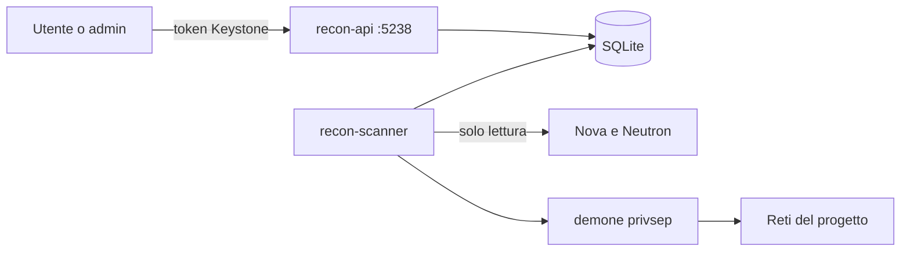

# Recon-Stack

**Service discovery senza agenti per OpenStack.** Scopre quali host e quali servizi girano davvero nelle reti di un progetto, li confronta con ciò che OpenStack dichiara e li pubblica in un catalogo consultabile da API REST e dashboard, aggiornato periodicamente.

> Progetto didattico per il corso di laurea magistrale in Sicurezza Informatica e Tecnologie Cloud (UNISA), sviluppato e provato esclusivamente in laboratorio su un'installazione DevStack dell'autore. È uno strumento difensivo di inventario: le scansioni riguardano solo le reti del progetto a cui sono rivolte.

---

## Scheda

| | |
| --- | --- |
| **Tipo** | nuovo servizio OpenStack, installato come plugin DevStack |
| **Linguaggio** | Python |
| **Componenti integrati** | Keystone (autenticazione), Nova e Neutron (sola lettura) |
| **Interfacce** | API REST e dashboard sulla porta 5238, comandi `openstack recon` |
| **Strumenti** | nmap, Graphviz |

---

## Il problema

OpenStack sa **cosa è dichiarato**: quali VM esistono, che indirizzi hanno, quali porte apre il firewall. Non sa **cosa gira davvero**: se sulla porta 22 c'è OpenSSH e in che versione, se nella rete risponde un host che nessuno ha registrato, se una regola del firewall apre una porta su cui non ascolta niente.

Gli strumenti che OpenStack offre (Horizon, il DNS Designate, il progetto di ricerca Searchlight, ritirato nel 2020) conoscono solo il dichiarato. Recon-Stack aggiunge l'osservato, senza installare niente dentro le VM.

## Cosa fa

- Legge da Nova e Neutron l'**inventario** del progetto: VM, porte, IP, floating IP, security group.
- Scopre gli **host attivi** nelle reti del progetto e segna come **sconosciuti** quelli che non hanno una porta Neutron.
- Scopre i **servizi** in ascolto: porta, protocollo, nome, versione.
- Li raccoglie in un **catalogo** cercabile per servizio, host, rete e versione.
- Ripete la scoperta **periodicamente** e mostra le **differenze** rispetto alla volta precedente.
- Distingue i servizi **interni** da quelli **esposti** tramite floating IP, e segnala le **regole di firewall inutili** e i **servizi latenti**.
- Produce una **mappa** della topologia e un **report** HTML/PDF, anche in versione condivisibile con indirizzi e identificativi oscurati.

## Vincoli di sicurezza

- Scansiona **solo** indirizzi delle subnet del progetto in Neutron e i suoi floating IP ([0005](docs/adr/0005-perimetro-da-neutron.md)).
- Le scansioni le avvia **solo chi ha il ruolo admin**, con un limite di frequenza ([0002](docs/adr/0002-autenticazione-keystone.md)).
- Ogni scansione viene registrata: chi, quando, su quale perimetro.
- Le operazioni privilegiate sono confinate in un demone privsep ([0007](docs/adr/0007-privilegi-oslo-privsep.md)).

## Cosa non fa

Non entra nelle VM e non installa agenti. Non modifica risorse OpenStack: non crea VM, porte né regole di firewall. Non cerca vulnerabilità né tenta di sfruttarle: rileva servizi e versioni.

---

## Architettura



Componenti, confini e sequenza di una scansione: [docs/architettura.md](docs/architettura.md).

---

## Provarlo

Nel `local.conf` di DevStack:

```ini
[[local|localrc]]
enable_plugin recon-stack https://github.com/suonatorefelice/recon-stack main
```

Dopo `./stack.sh` il servizio risponde su `http://<host>:5238`. Le istruzioni complete arriveranno con lo sviluppo: lo stato di avanzamento è in [docs/piano.md](docs/piano.md).

---

## Documenti

| Documento | Contenuto |
| --- | --- |
| [Concetti](docs/concetti.md) | OpenStack, DevStack, plugin, nmap e namespace di rete spiegati da zero |
| [Glossario](GLOSSARY.md) | i termini del dominio e dei componenti OpenStack |
| [Architettura](docs/architettura.md) | componenti, confini, sequenza di una scansione, dati conservati |
| [Decisioni](docs/adr/README.md) | le scelte di forma, con alternative scartate e fonti |
| [Piano](docs/piano.md) | gli step di sviluppo e come si verifica ciascuno |
