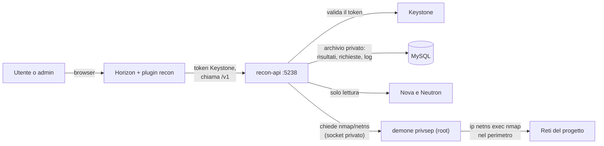
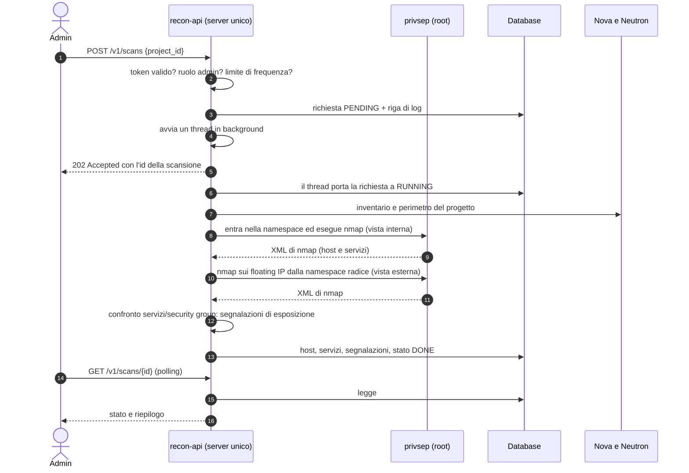

# Architettura

Chi fa cosa, dove passano i confini e in che ordine avvengono le cose. Le scelte che hanno prodotto questa forma sono negli [ADR](adr/README.md); qui si descrive il risultato. I termini sono nel [glossario](../GLOSSARY.md).

## Componenti

| Componente | Responsabilità | Non fa |
| --- | --- | --- |
| `recon-api` (il server unico) | un solo processo uwsgi sulla porta 5238, utente di servizio **non privilegiato**: verifica il token con Keystone, serve la API REST `/v1`, esegue le scansioni in un thread in background e le ripete con uno scheduler interno (APScheduler) ([0013](adr/0013-server-unico.md)) | non serve HTML di dashboard; non accetta comandi arbitrari; non entra da sé nelle namespace (lo fa privsep) |
| demone privsep | figlio **privilegiato** del server: esegue come root le sole funzioni dichiarate (entrare nella network namespace e lanciare nmap), su richiesta del server via un socket Unix privato ([0007](adr/0007-privilegi-oslo-privsep.md)) | non è un servizio a sé da avviare; non accetta comandi arbitrari, solo quelle funzioni con argomenti controllati |
| plugin Horizon | la dashboard web: pannelli Django aggiunti a Horizon che chiamano la API `/v1` col token dell'utente ([0010](adr/0010-dashboard-plugin-horizon.md)); pagina d'atterraggio **Riepilogo** (conteggi per gravità), più host, servizi, scansioni, con etichette italiane e badge colorati | non legge il database: i dati arrivano sempre dalla API (da Keystone legge solo l'elenco dei progetti per il menu "Avvia scansione"); la traduzione e l'aggregazione sono solo presentazione (modulo `labels`, funzione `build_summary`) |
| database MySQL | archivio privato del server: scansioni (richieste e log), host, servizi e segnalazioni, con lo storico | non è la verità sulle risorse: lo è OpenStack ([0001](adr/0001-database-mysql.md)) |

## Confini

- **Il servizio legge soltanto da OpenStack.** Nova e Neutron vengono interrogati per l'inventario e per il perimetro, mai modificati: nessuna VM, porta o regola di firewall viene creata o cambiata.
- **Si scansiona solo il perimetro.** I bersagli interni sono generati dal perimetro calcolato da Neutron, che ne impone anche la dimensione massima ([0005](adr/0005-perimetro-da-neutron.md)); l'ultima barriera prima di nmap è nel confine privsep, dove ogni bersaglio viene validato come IP valido e la namespace deve essere `ovnmeta-<uuid>` ([0007](adr/0007-privilegi-oslo-privsep.md)).
- **I privilegi restano confinati in privsep.** Il server è non privilegiato; le operazioni che richiedono root — entrare in una network namespace di Neutron per la vista interna — le esegue il demone privsep, con un insieme chiuso di funzioni ([0007](adr/0007-privilegi-oslo-privsep.md)). Dare le sole capability al server (senza privsep) è stato provato dal vivo e scartato: non bastano per `ip netns exec` su OVN ([0013](adr/0013-server-unico.md)). **Limite da non nascondere:** su DevStack l'utente `stack` ha `sudo NOPASSWD:ALL`, quindi privsep riduce la superficie d'attacco ma non è un confine rigido contro la compromissione totale del server; il suo valore è tenere i comandi root dietro funzioni tipizzate con input validati. rootwrap è stato valutato e non adottato ([0007](adr/0007-privilegi-oslo-privsep.md)).
- **L'identità viene da Keystone.** Chi ha chiesto una scansione lo dice il token validato, non un campo della richiesta ([0002](adr/0002-autenticazione-keystone.md)). Tutto `/v1` è riservato agli admin: un unico hook `before_request` autorizza ogni rotta prima di eseguirla, così un rifiuto (401/403) non scrive nulla nel database; `/health` resta pubblico.

## Sequenza di una scansione

Il report è una pagina stampabile della dashboard, costruita dalle stesse rotte `/v1` (scansione, segnalazioni, host e servizi): il server fornisce solo i dati. Il confronto con la scansione precedente (`GET /v1/scans/{id}/diff`) si calcola quando viene chiesto.

Le scansioni periodiche seguono gli stessi passi da 6 in poi: è lo scheduler interno (APScheduler) a creare la richiesta, a nome del servizio.

Stati di una scansione: `PENDING` (richiesta registrata), `RUNNING` (in corso), `DONE` (completata), `FAILED` (interrotta da un errore, con il motivo). Una richiesta senza ruolo admin, o troppo ravvicinata, viene fermata prima di scrivere nel database e resta solo nel log ([0002](adr/0002-autenticazione-keystone.md)). Il database contiene quindi solo scansioni vere.

## Dati conservati

| Tabella | Contenuto |
| --- | --- |
| `scans` | una riga per scansione: progetto, chi l'ha chiesta, quando, perimetro effettivo, stato, motivo dell'eventuale errore |
| `hosts` | gli host visti in una scansione: IP, rete, VM associata se c'è, classificazione (censito, sconosciuto, assente) |
| `services` | i servizi visti su un host in una scansione: porta, protocollo, nome, prodotto, versione, vista (interna o esterna) |
| `exposure_findings` | le segnalazioni di esposizione di una scansione: tipo, gravità, indirizzo e porta, e la spiegazione in italiano (tipi in `recon_stack/vocab.py`: regola inutile, servizio latente, esposto a chiunque, porta senza port security, host sconosciuto esposto, floating IP sprecato, raggiungibile da fuori, visto solo da fuori) |

Ogni scansione conserva i propri risultati: il catalogo è l'ultima scansione completata, lo storico sono le precedenti, il diff è il confronto fra due scansioni dello stesso progetto.

## Installazione

Il servizio si installa come plugin DevStack ([0009](adr/0009-plugin-devstack.md)):

| Fase di `stack.sh` | Cosa fa il plugin |
| --- | --- |
| `stack install` | installa il pacchetto Python e le dipendenze di sistema (nmap) |
| `stack post-config` | scrive `/etc/recon-stack/recon-stack.conf`, crea il database e lo schema (le tabelle, dai modelli), crea l'utente di servizio, registra il servizio `recon` e l'endpoint in Keystone |
| `stack post-config` (privsep) | configura il comando `helper_command` di privsep e la regola sudoers che permette al servizio di avviarlo come root ([0007](adr/0007-privilegi-oslo-privsep.md)) |
| `stack post-config` (dashboard) | copia il file "enabled" del plugin in Horizon, raccoglie i file statici (`collectstatic`) e riavvia Apache ([0010](adr/0010-dashboard-plugin-horizon.md)) |
| `stack extra` | avvia solo `recon-api` (uwsgi sulla porta 5238); il demone privsep lo avvia da sé alla prima scansione |
| `unstack` | ferma l'unico processo |
| `clean` | rimuove configurazione, dati e il plugin da Horizon |

## Verifiche su DevStack

Prove eseguite su DevStack (Ubuntu 24.04 aarch64 in VMware Fusion su Mac M1 Pro, driver di rete OVN), con il progetto creato da `demo/setup_demo.sh`.

- **Namespace** ([0006](adr/0006-vista-interna-namespace.md)): con OVN c'è una namespace `ovnmeta-<id rete>` per ogni rete con VM, e da lì la scansione raggiunge le VM del progetto. Verificato.
- **Vista esterna** ([0011](adr/0011-esposizione-e-segnalazioni.md)): dalla namespace radice del nodo il floating IP è raggiungibile e la porta 22 risponde. Verificato.
- **ARP e OVN**: nella stessa rete nmap, di norma, decide se un host è acceso con una richiesta ARP. OVN però risponde alle richieste ARP al posto delle VM, perché ne conosce già gli indirizzi: una VM spenta sembrerebbe accesa. La scoperta degli host usa quindi `--disable-arp-ping` (sonde ICMP e TCP, a cui risponde solo la VM vera). Limite accettato: una VM accesa il cui security group scarta tutte le sonde risulta assente.
- **Security group e vista interna**: il security group filtra anche il traffico che parte dalla namespace. Un servizio di prova sulla 9090, non permessa, risulta `filtered`; con una regola verso il solo indirizzo della namespace (`10.10.10.2/32`) risulta `open`. Lo scanner vede quindi solo ciò che il security group lascia passare: i servizi latenti si vedono solo con la regola dello scanner ([0012](adr/0012-regola-dello-scanner.md)).
- **Host sconosciuto**: un secondo indirizzo (`10.10.10.250`) aggiunto dentro una VM con la port security disattivata, quindi senza porta Neutron, viene trovato e classificato `unknown`. Verificato.
- **Port security disattivata**: una VM senza port security non ha security group, quindi è esposta a tutta la rete: produce la segnalazione `no_port_security`, non un "servizio latente". Verificato.
- **Test tempest**: `tempest run --regex recon_stack.tests.tempest` passa (scansione chiesta via API, eseguita dal server, host e segnalazioni presenti).
- **Report**: è una pagina stampabile della dashboard (azione "Report" sulle scansioni completate), costruita dalle rotte `/v1`; il PDF si ottiene stampando dal browser.

