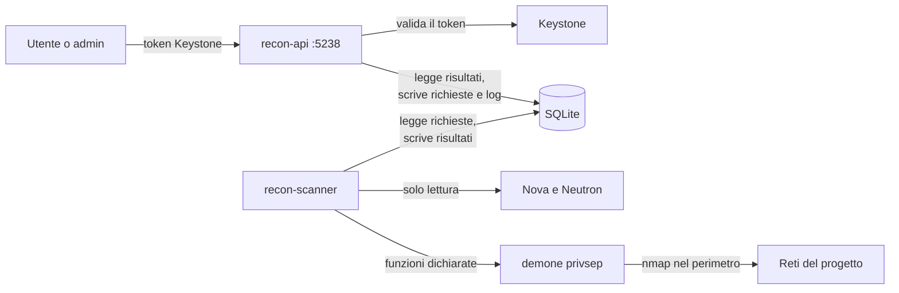
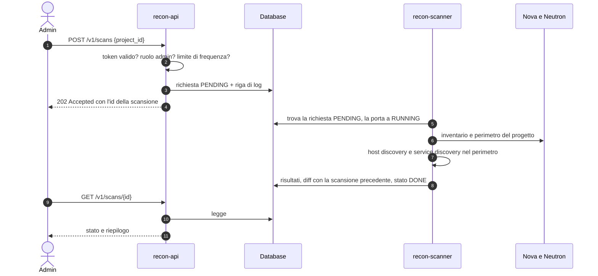

# Architettura

Chi fa cosa, dove passano i confini e in che ordine avvengono le cose. Le scelte che hanno prodotto questa forma sono negli [ADR](adr/README.md); qui si descrive il risultato. I termini sono nel [glossario](../GLOSSARY.md).

## Componenti

| Componente | Responsabilità | Non fa |
| --- | --- | --- |
| `recon-api` | riceve le richieste HTTP sulla porta 5238, verifica il token con Keystone, serve la API REST `/v1` e la dashboard, registra le richieste di scansione e il log dei tentativi | non esegue scansioni, non ha privilegi ([0004](adr/0004-scheduler-separato.md), [0007](adr/0007-privilegi-oslo-privsep.md)) |
| `recon-scanner` | esegue le scansioni periodiche e quelle richieste: legge l'inventario, calcola il perimetro, scopre host e servizi, riconcilia e salva | non riceve richieste HTTP, non ha privilegi propri |
| demone privsep | esegue, su richiesta di `recon-scanner`, le sole funzioni dichiarate come privilegiate | non accetta comandi arbitrari ([0007](adr/0007-privilegi-oslo-privsep.md)) |
| database SQLite | inventario, risultati, storico, richieste e log delle scansioni | non è la verità sulle risorse: lo è OpenStack ([0001](adr/0001-database-sqlite.md)) |

## Confini

- **Il servizio legge soltanto da OpenStack.** Nova e Neutron vengono interrogati per l'inventario e per il perimetro, mai modificati: nessuna VM, porta o regola di firewall viene creata o cambiata.
- **Si scansiona solo il perimetro.** Ogni bersaglio passa dal controllo del perimetro calcolato da Neutron prima di arrivare a nmap ([0005](adr/0005-perimetro-da-neutron.md)).
- **I privilegi stanno in un punto solo.** API e scanner girano come utente non privilegiato; ciò che richiede privilegi passa da privsep.
- **L'identità viene da Keystone.** Chi ha chiesto una scansione lo dice il token validato, non un campo della richiesta ([0002](adr/0002-autenticazione-keystone.md)).

## Sequenza di una scansione

Le scansioni periodiche seguono gli stessi passi da 5 in poi: è lo scheduler a creare la richiesta, a nome del servizio.

Stati di una scansione: `PENDING` (richiesta registrata), `RUNNING` (in corso), `DONE` (completata), `FAILED` (interrotta da un errore, con il motivo), `REJECTED` (rifiutata prima di partire: ruolo, frequenza o perimetro).

## Dati conservati

| Tabella | Contenuto |
| --- | --- |
| `scans` | una riga per scansione: progetto, chi l'ha chiesta, quando, perimetro effettivo, stato, motivo dell'eventuale errore |
| `hosts` | gli host visti in una scansione: IP, rete, VM associata se c'è, classificazione (censito, sconosciuto, assente) |
| `services` | i servizi visti su un host in una scansione: porta, protocollo, nome, prodotto, versione, vista (interna o esterna) |
| `inventory_*` | la fotografia dell'inventario usata dalla scansione: VM, porte Neutron, floating IP, security group e regole |

Ogni scansione conserva i propri risultati: il catalogo è l'ultima scansione completata, lo storico sono le precedenti, il diff è il confronto fra due scansioni dello stesso progetto.

## Installazione

Il servizio si installa come plugin DevStack ([0009](adr/0009-plugin-devstack.md)):

| Fase di `stack.sh` | Cosa fa il plugin |
| --- | --- |
| `stack install` | installa il pacchetto Python e le dipendenze di sistema (nmap, graphviz) |
| `stack post-config` | scrive `/etc/recon-stack/recon-stack.conf`, crea il database ed esegue le migrazioni, crea l'utente di servizio, registra il servizio `recon` e l'endpoint in Keystone |
| `stack extra` | avvia `recon-api` (uwsgi sulla porta 5238) e `recon-scanner` |
| `unstack` | ferma i due processi |
| `clean` | rimuove configurazione e dati |

## Punti da verificare su DevStack

- Il driver di rete in uso (OVN od OVS) e quindi i nomi delle namespace ([0006](adr/0006-vista-interna-namespace.md)).
- Come i security group delle VM trattano il traffico della vista interna: decide cosa la scansione può vedere, e quindi come si riconosce un servizio latente.
